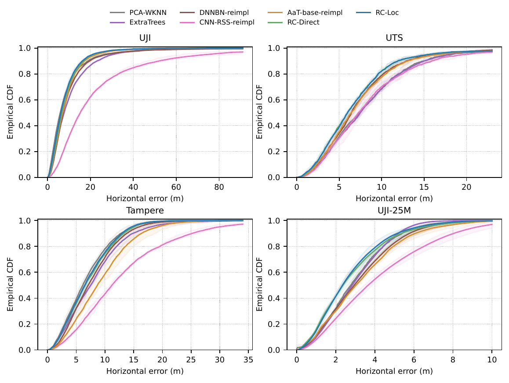
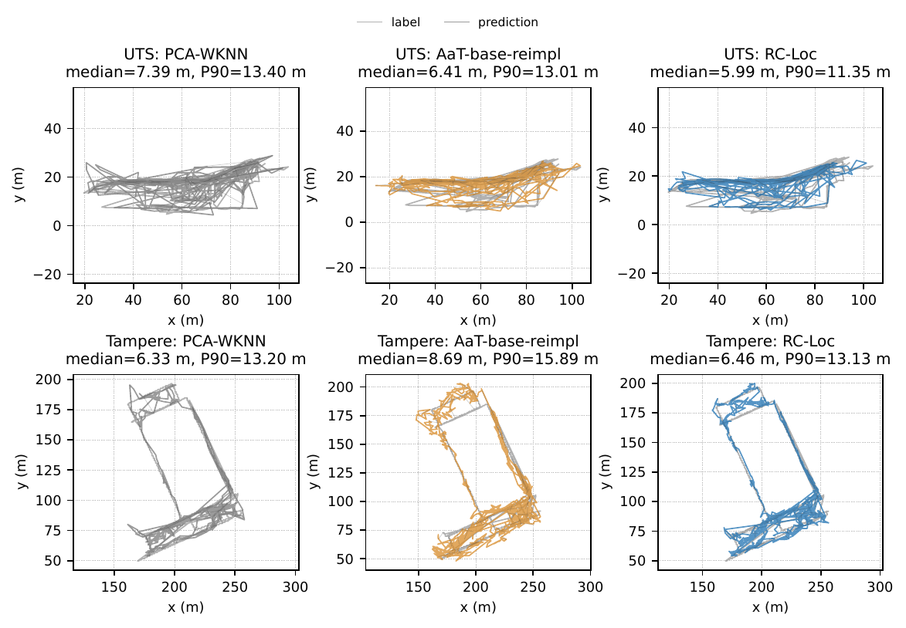
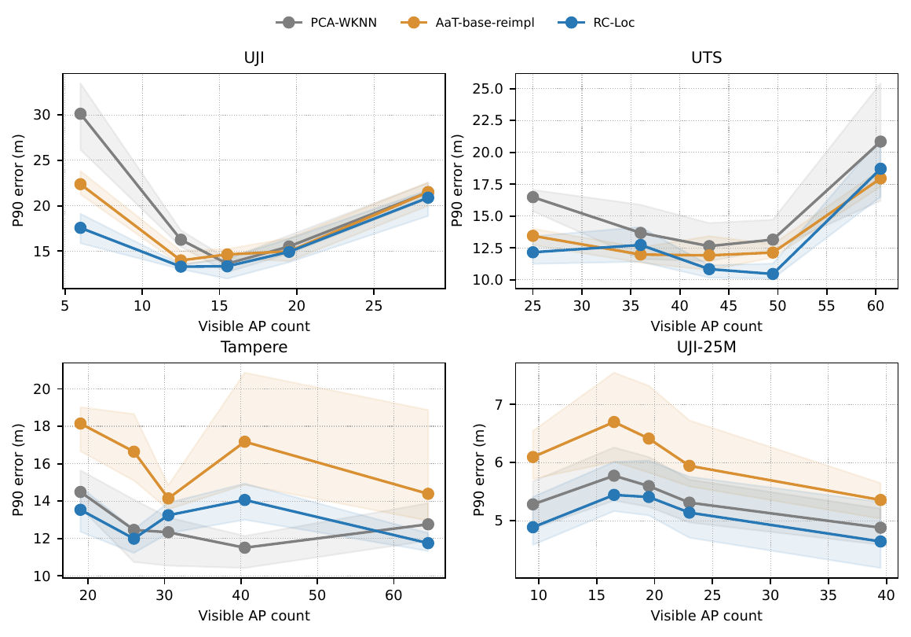
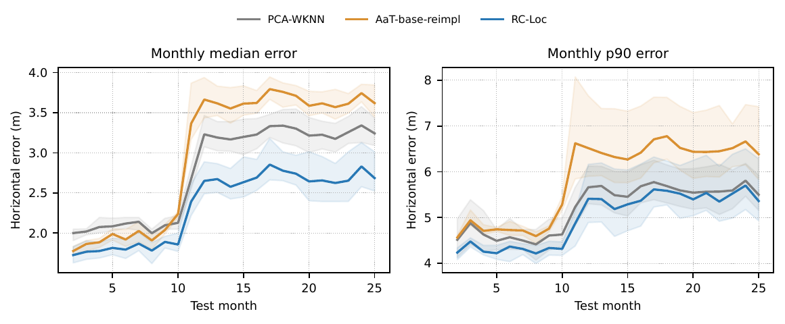
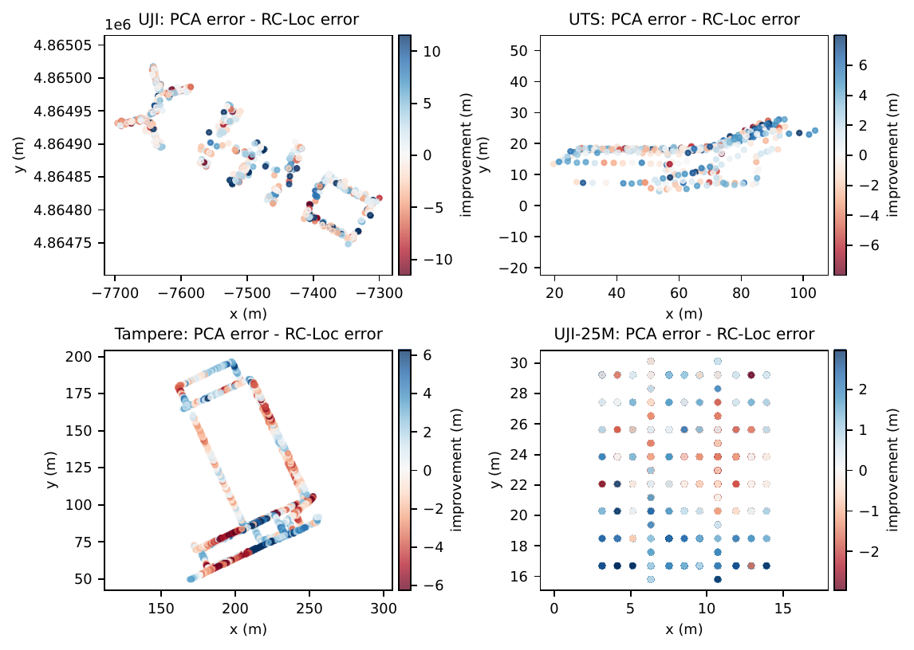

# Supplementary material

## Accompanying manuscript

**RC-Loc: Leveraging Mask Perception and Corruption Consistency for Wi-Fi Fingerprint Localization With Indoor Radio Maps**

This directory provides the supplementary distributional, spatial, and temporal diagnostics referenced in the manuscript. Figures S1–S5 retain the original figure PDFs from the manuscript's revision materials. PNG previews are rendered from those PDFs; no experimental results have been recomputed or altered for this release.

## Figure index

| Figure | Diagnostic | Original PDF |
|---|---|---|
| [S1](#s1-error-ecdfs) | Error empirical cumulative distribution functions (ECDFs) | [PDF](figures/extended_error_ecdf.pdf) |
| [S2](#s2-ground-truth-and-prediction-overlays) | Ground-truth and prediction overlays | [PDF](figures/extended_label_prediction_overlays.pdf) |
| [S3](#s3-error-conditional-on-visible-ap-count) | P90 error conditional on visible-AP count | [PDF](figures/extended_visible_ap_strata.pdf) |
| [S4](#s4-month-by-month-forward-time-evaluation) | Month-by-month forward-time evaluation | [PDF](figures/extended_monthly_forward_time.pdf) |
| [S5](#s5-spatial-error-differences) | Spatial error differences relative to PCA-WKNN | [PDF](figures/extended_spatial_error_improvement.pdf) |

## Evaluation conventions

- Horizontal localization error is the Euclidean distance between the predicted and ground-truth coordinates, in metres. P90 denotes the 90th percentile of this error.
- The five training/selection seeds are `11, 22, 33, 44, 55`. S2 is a single-seed illustration using seed `33`; the remaining diagnostics summarize the five seeds.
- Dataset abbreviations in the panels are UJI (UJIIndoorLoc), UTS (UTSIndoorLoc), Tampere, and UJI-25M (UJI-Library-25M).
- Shaded bands in S1, S3, and S4 show the minimum-to-maximum range across seeds. They are not confidence intervals. The seeded training/selection run remains the inferential unit for the manuscript's statistical comparisons.
- These figures retain dataset-specific exceptions and local losses; they do not imply that RC-Loc improves every metric, sample, or location.

## S1. Error ECDFs

**Fig. S1.** Empirical cumulative distribution functions of horizontal localization error on the designated test sets of UJIIndoorLoc, UTSIndoorLoc, Tampere, and UJI-Library-25M. Each curve is the arithmetic mean of the per-seed ECDFs at a common error threshold; shading shows the minimum and maximum across the five seeds. The methods are PCA-WKNN, ExtraTrees, DNNBN-reimpl, CNN-RSS-reimpl, AaT-base-reimpl, RC-Direct, and RC-Loc.

At a given error threshold, a higher ECDF means that a larger fraction of test queries falls within that threshold. Crossing curves retain differences between central and tail performance rather than reducing each distribution to one summary statistic. This is the ECDF diagnostic referenced in the main text.

[Original PDF](figures/extended_error_ecdf.pdf) · [PNG preview](figures/extended_error_ecdf.png)

## S2. Ground-truth and prediction overlays

**Fig. S2.** Ground-truth and predicted-coordinate overlays on the UTSIndoorLoc and Tampere test sets for PCA-WKNN, AaT-base-reimpl, and RC-Loc. All methods use the same test queries and seed `33`. Panel titles report that run's median and P90 horizontal errors. Coordinates are shown in metres with equal horizontal and vertical spatial scaling; selected connecting segments indicate query-level displacements between labels and predictions.

These panels visualize prediction geometry for a fixed run. Their numerical annotations are single-seed values, not the five-seed means reported in the main comparison tables. Lines connect samples in their stored order and should not be interpreted as a reconstructed physical movement trajectory.

[Original PDF](figures/extended_label_prediction_overlays.pdf) · [PNG preview](figures/extended_label_prediction_overlays.png)

## S3. Error conditional on visible-AP count

**Fig. S3.** P90 horizontal localization error conditional on the number of visible access points (APs), comparing PCA-WKNN, AaT-base-reimpl, and RC-Loc. Within each dataset, test-query visible-AP-count quantiles define common strata for all methods and seeds. The horizontal positions are stratum midpoints. Curves show the mean of the within-stratum P90 errors computed separately for the five seeds; shaded bands show their minimum-to-maximum range.

This diagnostic examines how tail error varies with AP visibility under common strata. The panels report **P90 only**, not median error. Stratum boundaries are fixed across methods within a dataset, but differ between datasets.

[Original PDF](figures/extended_visible_ap_strata.pdf) · [PNG preview](figures/extended_visible_ap_strata.png)

## S4. Month-by-month forward-time evaluation

**Fig. S4.** Forward-time evaluation on UJI-Library-25M, comparing PCA-WKNN, AaT-base-reimpl, and RC-Loc. Training and selection use month 1; the fitted models and month-1 radio map remain frozen while months 2–25 are evaluated in chronological order without target-month updating. The left and right panels report monthly median and P90 horizontal errors, respectively. Curves are the means of the per-seed monthly metrics; shaded bands show the minimum and maximum across the five seeds.

The figure preserves month-specific changes that are hidden by a single aggregate temporal-test score. It evaluates forward-time robustness, not online adaptation or periodic retraining.

[Original PDF](figures/extended_monthly_forward_time.pdf) · [PNG preview](figures/extended_monthly_forward_time.png)

## S5. Spatial error differences

**Fig. S5.** Spatial distribution of paired horizontal-error differences between PCA-WKNN and RC-Loc at ground-truth test-query locations. For each query, the plotted quantity is the mean across the five seeds of `e_PCA-WKNN − e_RC-Loc`, in metres. Positive values (blue) indicate lower RC-Loc error; negative values (red) indicate lower PCA-WKNN error. Both local gains and losses are retained.

Each panel uses its own symmetric colour scale, with colour saturation at the 95th percentile of the absolute seed-averaged differences in that dataset. Thus colour intensity should be read against the panel's own colour bar; the saturation is a display convention, not removal of test queries or a change to reported error statistics. These maps are descriptive and do not establish location-wise statistical significance.

[Original PDF](figures/extended_spatial_error_improvement.pdf) · [PNG preview](figures/extended_spatial_error_improvement.png)

## Provenance and reproduction

The corresponding plotting functions are in [`analyze_twc_extended.py`](../RC_Loc%20code/scripts/analyze_twc_extended.py):

| Figure | Plotting function |
|---|---|
| S1 | `plot_ecdf` |
| S2 | `plot_label_overlays` |
| S3 | `plot_visibility_strata` |
| S4 | `plot_long_term` |
| S5 | `plot_spatial_improvement` |

Descriptions above are aligned with the displayed quantities and the plotting implementation. In particular, S1 uses an average of per-seed ECDFs, S2 uses one fixed seed, and S3 reports P90 rather than both median and P90.

Regenerating the plots requires the corresponding saved query-level predictions and, for stratification and temporal grouping, the dataset inputs. These arrays and third-party raw datasets are not included in the compact public repository. See the [code package](../RC_Loc%20code/README.md) and [experimental protocol](../RC_Loc%20code/docs/experiment_protocol.md) for the data layout and experiment workflow. The original PDFs and browser previews here can be viewed independently of those inputs.

Please cite the accompanying manuscript when using these supplementary research figures.
